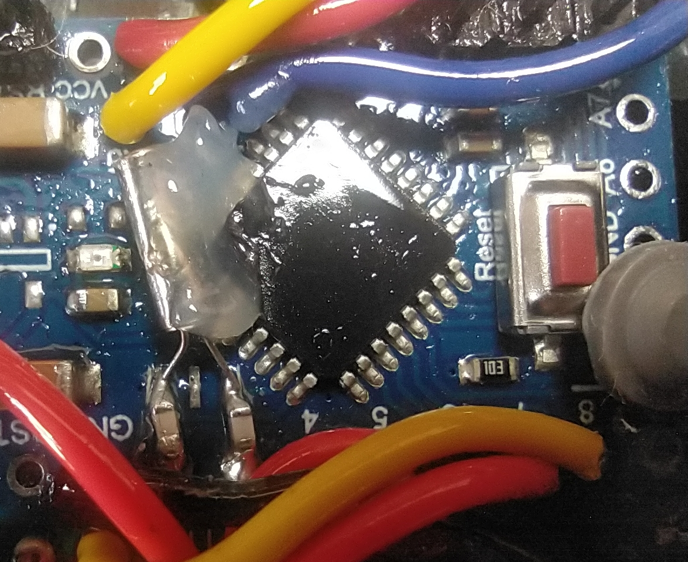
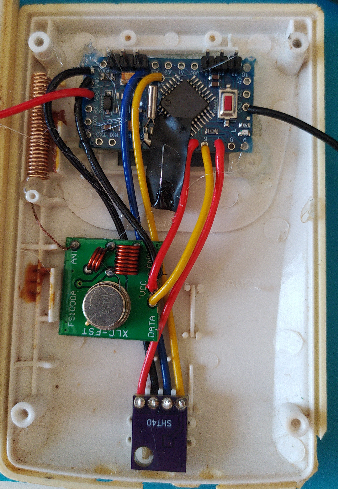

# Emulador de sensores meteorológicos Oregon Scientific V3

**Emulador de sensores meteorológicos compatibles con el protocolo Oregon Scientific V3. Este proyecto surge de la necesidad de sustituir los sensores originales por una solución alternativa, capaz de reproducir su comportamiento y garantizar la compatibilidad con los receptores existentes.**

## Índice

- Sensores emulados
- Objetivos
- Características
- Hardware
- Conexiones
- Recepción de los receptores originales
- Configuración de emulación
- Descubrimientos
- Trabajo a futuro
- Conclusión
- Licencia
- Créditos y agradecimientos

## Sensores emulados

- **Sensores de temperatura y humedad (oregon-thgr810.ino)**
    - Oregon scientific THGR810
    - Oregon scientific THGR800
    - Oregon scientific THGN800
    - Oregon scientific THGN801
- **Pluviómetro (oregon-pcr800.ino):**
    - Oregon scientific PCR800
- **Anemómetro y veleta (oregon-wgr800.ino):**
    - Oregon Scientific WGR800
- **Sensor UV (oregon-uvn800.ino):**
    - Oregon Scientific UVN800

## Objetivos

- **Temporización robusta sin calibración individual: garantizar el funcionamiento en distintas placas Arduino basadas en el ATmega328 o similares, minimizando el impacto de las variaciones de frecuencia de sus osciladores.**
- **Bajo consumo energético: optimizar el funcionamiento del emulador para reducir el consumo y favorecer su autonomía en aplicaciones alimentadas por batería.**
- **Emulación de alta fidelidad: reproducir con la máxima precisión posible las mismas tramas que los sensores originales.**


## Características
- **Dos modos de temporización:**
    - *Optimizado* (`enable_opt`): Timer2 asíncrono con cristal de 32,768 kHz. Sin calibración y con suspensión profunda entre emisiones (consumo en reposo de 3uA).
    - *Estándar*: basado en `micros()` / `delayMicroseconds()`, compatible con cualquier Arduino.
- **Modos de sincronización** configurables para el emparejamiento con receptores originales.
- **Detección de batería baja** mediante la lectura de VCC con la referencia interna.
- Intervalo de emisión, canal e identificador configurables.
- Alimentación del emisor RF controlada por software: solo se energiza durante la transmisión.

## Hardware
- Microcontrolador:
    - ATmega328PB.
    - ATmega328P.
- Emisor de RF:
    - Módulo OOK 433 MHz FS1000A

Con este hardware, existen dos tipos de configuraciones que se pueden realizar:

- **Modo Optimizado** (`enable_opt`)
    
    **Este requiere un ATmega328 o similar para funcionar**, ya que depende de la librería de suspensión, la forma de configurar el Timer2 en modo asíncrono y otros parámetros.
    
    Para usar este modo, necesitan diferentes componentes:
    
    - **Oscilador de 32,768 Khz:** este se debe de soldar en los pines “XTAL1 y XTAL2”.
    - **Un par de condensadores:** normalmente de 12pF (se deben de conectar del XTAL1 y XTAL2 a GND).
    
    En la siguiente imagen pueden ver el diagrama y un ejemplo de una modificación real:
    
    ```
                      ┌────────┤ ├────────┐      ← Cristal 32,768 kHz
                      │                   │
        XTAL1 ────────┤                   ├──────── XTAL2
                      │                   │         
                	 ─┴─ C1              ─┴─ C2
                     ─┬─                 ─┬─
                      │                   │
                     GND                 GND
                 
    
    ```
    
    **Importante:** estos pines se usan normalmente para un oscilador externo de 16Mhz/8Mhz, por lo que al usar el oscilador de 32Khz, **se debe utilizar el oscilador interno del propio arduino como principal**. Configura los fuses o bootloader de forma que no use cristal externo para el reloj del sistema.
    
    
    
- **Modo Estándar**
    
    Este modo no requiere ningún hardware adicional y es compatible con cualquier arduino, pero se deberá realizar una calibración del parámetro `V3_PULSE_LENGHT_US`  para que la duración de los pulsos Manchester coincida con lo que realmente acepta el receptor original. Más información en el apartado de configuración.
    

## Conexiones

| Pin | Constante | Función |
| --- | --- | --- |
| 8 | `RF433_TX_PIN` | Datos hacia el emisor RF 433 MHz |
| 7 | `RF433_VCC` | Alimentación del emisor (activa solo durante la emisión) |
| 5 | `LED_PIN` | Indicador de emisión y errores |

## Recepción de los receptores originales

Este apartado se centra en los conceptos básicos y las variables principales que intervienen en la recepción de los sensores Oregon Scientific V3. Se ofrece una visión de cómo se capta la señal y de los parámetros necesarios para establecer la comunicación, sin entrar en detalle en aspectos como la codificación de los datos, el cálculo del *checksum* o la estructura interna de las tramas.

Este programa está preparado para que **cualquiera de las estaciones receptoras Oregon V3 reciban los sensores.** Las que he usado para testear el programa son las siguientes:

- **Oregon Scientify WMR86**
- **Oregon Scientify WMR88**
- **Oregon Scientify WMR180**

### Conceptos clave

Dentro del protocolo V3, debemos de tener presente los siguientes conceptos que son clave:

- **Duración de un pulso (`V3_PULSE_LENGHT_US`):** es el tiempo que permanece una señal en un determinado estado lógico (`HIGH` o `LOW`), medido en microsegundos (µs). Las receptoras requieren un tiempo medio entre: `487.7 - 489.0us` .
- **Periodo de emisión** (**`V3_TX_INTERVAL_SECS`):** este determina la frecuencia en la que el sensor enviará los datos (s). Esta varía en función de el tipo de sensor y el canal establecido.
- **Identidad del sensor** **(`sensor_id`)**: indica el tipo de sensor (UVN800, WGR800, THGN810).
- **Canal del sensor (`V3_CHANNEL`):** indica el canal por el que está emitiendo el sensor. Este se usa en los sensores de temperatura.
- **Código de sesión del sensor** **(`rcode`)**: también llamado “**Rolling Code**”, se utiliza para identificar un sensor concreto frente a otros del mismo tipo/canal.
- **Modo emparejamiento (`pair_mode`):** este es el encargado de distinguir si un sensor se acaba de encender o reiniciar.

### Tipos de escaneo de los receptores

Los receptores originales disponen de diferentes mecanismos de búsqueda y reconocimiento de sensores. El comportamiento depende del estado del receptor y de si existe un sensor previamente vinculado. En esta implementación, se distinguen dos situaciones principales:

- **Escaneo inicial:** se produce cuando se inicializa el receptor.
    - El receptor comprueba el identificador del sensor y el canal de transmisión.
    - Si reconoce un sensor compatible, almacena su código de sesión (*rolling code*) y lo asocia a la combinación de identificador y canal.
    - Una vez establecida esta asociación, los sensores que presenten el mismo identificador y canal, pero un código de sesión diferente, serán ignorados.
- **Modo *Search*:** se activa cuando el usuario selecciona la función de búsqueda de sensores en la estación receptora. En este modo, el comportamiento depende de si existe una vinculación previa:
    - **Si no existe un sensor vinculado:**
        - El receptor busca sensores compatibles y, cuando detecta uno válido, realiza el mismo procedimiento de identificación y vinculación que durante el escaneo inicial.
    - **Si ya existe un sensor vinculado:**
        - El receptor comprueba si ha perdido la comunicación con el sensor asociado. En estos casos, se considera que existe una pérdida de comunicación cuando transcurren aproximadamente cinco minutos sin recibir datos.
        - Si se ha perdido la comunicación, el receptor comprueba si el sensor nuevo captado tiene habilitado el modo de emparejamiento.
            - **Si el modo de emparejamiento está habilitado**, el receptor puede aceptar el nuevo código de sesión y asociarlo al identificador y canal correspondientes, restableciendo la vinculación.
            - **Si el modo de emparejamiento está deshabilitado**, el receptor ignora los datos del sensor que presenta el nuevo código de sesión y continúa esperando al sensor previamente vinculado.

### Problemas de recepción

Cuando un receptor no capta los mensajes enviados por un sensor, aparte de los factores como la distancia y la corrupción del mensaje, puede ser:

- **Duración de un pulso:** si el sensor esperado está emitiendo y el receptor acaba de encenderse o realizar un Search y no es captado, uno de los problemas puede ser que la duración del pulso `HIGH` o `LOW` . Esto en los sensores originales se suele deber a la degradación del oscilador 32Khz que utilizan. En los sensores emulados se puede dar en los siguientes casos:
    - Se está utilizando el oscilador interno del arduino para generar los pulsos (es cuando se ha eliminado el oscilador externo que tenía, y se está usando sin el modo enable_opt).
    - Se está utilizando el oscilador externo para generar los pulsos y no se ha ajustado el **`V3_PULSE_LENGHT_US`**.
    - Se está utilizando el (enable_opt) pero el oscilador de 32Khz está muy descalibrado o estropeado.
- **Periodo de emisión:** en caso de que el receptor capte los mensajes del sensor durante el escaneo inicial o el modo Search pero tras acabar este pierde la señal del sensor, se suele deber a que **`V3_TX_INTERVAL_SECS`** no es el adecuado para el tipo de sensor / canal.

## Configuración de emulación

En esta sección, se detalla la configuración del programa para tener la funcionalidad esperada.

### Modo de programa (`mod_program`)

Define el comportamiento del emparejamiento y del *rolling code*. En la siguiente tabla se puede ver la función de cada modo:

| **Valor** | **Modo emparejamiento** | **Rolling code** | **Descripción** |
| --- | --- | --- | --- |
| `0` | 30 min tras el arranque | Aleatorio | Emulación fiel del sensor original. Tras un reinicio, el receptor requiere un nuevo *Search* dentro de los primeros 30 min. |
| `1` | 30 min tras el arranque | Fijo | **Recomendado.** Tras un reinicio o corte de energía, el receptor vuelve a detectar el sensor sin intervención. |
| `2` | Siempre activa | Fijo | Cualquier receptor puede registrarlo en cualquier momento. Con varios sensores del mismo tipo y canal, el receptor puede sincronizarse con otro. |
| `3` | Desactivada | Fijo | Si el *rolling code* cambia, hay que resetear el receptor; un *Search* no es suficiente. |
| `4` | Desactivada | Aleatorio | No recomendado. |

En los modos con *rolling code* fijo (`1`, `2` y `3`), modifica `rcode` cuando haya varios dispositivos con el mismo `sensor_id` y canal, para evitar colisiones.

### Optimización del consumo (`enable_opt`)

El programa dispone de dos modos de funcionamiento, seleccionados mediante la directiva `enable_opt`. Esta opción determina cómo se generan los pulsos Manchester y cómo se gestiona el consumo energético del microcontrolador.

- **Modo optimizado (`#define enable_opt`):** habilita el uso del oscilador de 32,768 kHz para la temporización de los pulsos Manchester mediante el Timer2 y permite utilizar funciones de suspensión para reducir el consumo energético del microcontrolador.
    - Debe habilitarse únicamente si el hardware dispone del cristal de 32,768 kHz y de la configuración necesaria para utilizarlo.
    - Requiere la biblioteca [Low-Power-Canique](https://github.com/canique/Low-Power-Canique) para el bajo consumo, concretamente la rama `master`, que incorpora soporte para el ATmega328PB.
    - Este modo permite prescindir de las funciones `micros()` y `delayMicroseconds()` para la temporización de los pulsos, utilizando en su lugar el temporizador configurado con el oscilador de 32,768 kHz.
- **Modo estándar (`// #define enable_opt`):** cuando la opción está deshabilitada, el programa utiliza las funciones `micros()` y `delayMicroseconds()` para controlar la duración de los pulsos Manchester. En esta configuración no se utiliza el mecanismo de suspensión asociado al modo optimizado.
    - **`V3_PULSE_LENGHT_US`:** define la duración de referencia de cada mitad del bit Manchester. Su valor debe ajustarse para conseguir una temporización compatible con la que esperan las estaciones receptoras Oregon Scientific V3.
    - **Ajuste de la temporización:** se recomienda modificar este parámetro en incrementos de +-0,2 µs y comprobar después si la estación receptora reconoce correctamente los mensajes transmitidos. Si no se capta el sensor o a veces lo capta y otras no, hay que seguir modificando este ajuste.
    - No existe un valor universal que garantice la compatibilidad con todos los receptores y configuraciones. El resultado depende de:
        - La calibración del oscilador externo que uses.
        - La tolerancia del receptor que es de +-1.3 µs aproximadamente.
    - No obstante, a futuro traeré un programa receptor de OregonV3 para arduino que se encargará de ver aproximadamente el **`V3_PULSE_LENGHT_US`** que está emitiendo el emisor.
    
    > No se recomienda utilizar osciladores internos para generar los pulsos Manchester: pequeñas variaciones de tensión o temperatura pueden sacar de rango la duración de los periodos.
    > 

En ambos modos, el objetivo es mantener una temporización suficientemente precisa para que las estaciones receptoras puedan decodificar correctamente los datos transmitidos. La diferencia principal es que el modo optimizado utiliza el temporizador asociado al cristal de 32,768 kHz y permite reducir el consumo, mientras que el modo estándar se basa en las funciones de temporización habituales de Arduino.

### Identidad y emisión

| Parámetro | Descripción |
| --- | --- |
| `sensor_id` | Identificador del dispositivo |
| `V3_CHANNEL` | Canal (0–15), cada tipo de sensor trae un canal concreto. |
| `rcode` | *Rolling code* fijo *(explicado en Modo de Programa)* |
| `V3_TX_INTERVAL_SECS` | Segundos entre emisiones (depende del tipo de sensor y del canal) |
| `V3_PAYLOAD_NIBBLES` | Nibbles del payload considerados en los checksums |
| `V3_TX_BYTES` | Longitud total de la trama en bytes |

### Detección de batería baja

| Parámetro | Valor por defecto | Descripción |
| --- | --- | --- |
| `check_voltaje_batery` | `1` | `1` habilita la comprobación; `0` la deshabilita (se indica siempre batería OK) |
| `vol_low` | `2.7` | Umbral (V) por debajo del cual se indica batería baja |
| `vol_calibrate` | `0` | Offset (V) para ajustar la lectura de VCC a la tensión real |

### Parámetros específicos de sensor THGR810

El sensor de temperatura tiene los siguiente variables extras:

- **Configuración del intervalo de emisión (`V3_Default_INTERVALS_SECS`):**
    - El programa permite seleccionar entre dos modos de configuración del intervalo de emisión de los sensores mediante la variable `V3_Default_INTERVALS_SECS`. Este parámetro determina si se utilizan los intervalos de transmisión predeterminados de los sensores Oregon Scientific originales o si se establece manualmente el tiempo entre emisiones.
        - **Intervalos predeterminados (`V3_Default_INTERVALS_SECS = 0`):** el programa emula los intervalos de emisión de los sensores originales. Estos varían en función del canal configurado, por lo que no todos los sensores transmiten con la misma periodicidad.
        - **Intervalo manual (`V3_Default_INTERVALS_SECS = 1`):** permite establecer un intervalo de emisión personalizado mediante la variable `V3_TX_INTERVAL_SECS`.
- **Cálculo de tendencias de temperatura y humedad (`calculate_trends`)**
    - El programa incorpora un algoritmo para calcular las tendencias de temperatura y humedad, con el objetivo de emular los indicadores *(flechas)* de tendencia que aparecen en las estaciones meteorológicas receptoras Oregon Scientific V3. Estos indicadores permiten mostrar si la temperatura o la humedad se mantienen estables, aumentan o disminuyen respecto a las mediciones anteriores. Los parámetros a modificar son los siguientes:
        - **Activación del cálculo (`calculate_trends`):** permite habilitar o deshabilitar el algoritmo de tendencias.
            - `0`: desactivado.
            - `1`: activado.
        - Configuración de los umbrales:
            - El algoritmo permite ajustar la sensibilidad con la que se detectan las variaciones de temperatura y humedad mediante los siguientes parámetros:
                
                
                | Variable | Valor predeterminado | Función |
                | --- | --- | --- |
                | `temp_th_estable` | `0.05` | Umbral asociado a la estabilidad de la temperatura. |
                | `temp_th_up` | `0.08` | Umbral para detectar una tendencia ascendente de temperatura. |
                | `temp_th_down` | `-0.08` | Umbral para detectar una tendencia descendente de temperatura. |
                | `hum_th_estable` | `0.15` | Umbral asociado a la estabilidad de la humedad. |
                | `hum_th_up` | `0.3` | Umbral para detectar una tendencia ascendente de humedad. |
                | `hum_th_down` | `-0.3` | Umbral para detectar una tendencia descendente de humedad. |
            
            Estos valores permiten adaptar el comportamiento del algoritmo a las variaciones de las mediciones. En general, modificar los umbrales cambia la sensibilidad con la que se reconocen las tendencias, aunque su efecto exacto depende de cómo se utilicen en las funciones de cálculo.
            

## Descubrimientos

Durante la fase de investigación de este proyecto, el análisis de numerosas tramas transmitidas por sensores originales de Oregon Scientific permitió identificar varios comportamientos relacionados con la interpretación de los datos por parte de las estaciones receptoras. Algunos de estos hallazgos, descritos parcialmente en apartados anteriores, surgieron a partir de pruebas experimentales realizadas durante el desarrollo del emulador.

No se ha podido determinar si todos estos comportamientos ya habían sido documentados previamente. Por tanto, se presentan como resultados obtenidos durante esta investigación, distinguiendo entre las observaciones experimentales y las conclusiones derivadas de ellas.

### Múltiples usos del nibble de batería baja

Durante el análisis de las transmisiones de distintos sensores originales, se observó que el nibble inicialmente asociado al estado de la batería podía adoptar diferentes valores en función del momento transcurrido desde el reinicio del sensor.

En las primeras observaciones, el nibble presentaba el valor `0x8` inmediatamente después de reiniciar el dispositivo. Sin embargo, aproximadamente 30 minutos después, pasaba a `0x0`, manteniéndose el indicador de batería en estado correcto. Este comportamiento se repitió en los distintos sensores analizados.

Para comprobar si estos valores también estaban relacionados con el estado de la batería, se realizaron pruebas reduciendo la tensión de alimentación por debajo de 2,7 V, con el objetivo de provocar la indicación de batería baja. En estas condiciones, durante los primeros 30 minutos se observó el valor `0xC`, que posteriormente cambiaba a `0x4`.

La repetición de este patrón permitió establecer una correspondencia entre los dos bits más significativos de este campo y dos estados independientes: el nivel de batería y el estado de sincronización. En concreto, los valores `0x8` y `0xC` aparecían asociados a la sincronización habilitada, mientras que `0x0` y `0x4` correspondían a la sincronización deshabilitada.

Esta hipótesis se reforzó mediante pruebas con una modificación del programa `oregon-uvn800.ino`, desarrollado por Lars Wessels. Durante estas pruebas, se observó que las estaciones receptoras originales no permitían cambiar directamente de un sensor UVN800 con un *Rolling Code* determinado a otro que utilizara un código diferente, sin reiniciar previamente la estación.

A partir de este comportamiento, se planteó que el valor `0x8` podía estar relacionado con el proceso de sincronización, reconocimiento o vinculación del sensor. Las pruebas posteriores con el emulador respaldaron esta interpretación: al iniciar una nueva emulación con otro *Rolling Code*, era posible esperar a que el receptor dejara de recibir el sensor previamente vinculado y, posteriormente, iniciar un escaneo mediante el modo *Search*.

Los resultados experimentales permitieron establecer la siguiente correspondencia entre el valor del nibble, el estado de la batería y la sincronización:

| Valor hexadecimal | Estado de la batería | Sincronización |
| --- | --- | --- |
| `0x0` | Batería OK | Deshabilitada |
| `0x4` | Batería baja (Low) | Deshabilitada |
| `0x8` | Batería OK | Habilitada |
| `0xC` | Batería baja (Low) | Habilitada |

Por tanto, este campo no debe interpretarse exclusivamente como un indicador de batería baja. Sus valores también proporcionan información relacionada con la sincronización del sensor, lo que resulta relevante para reproducir el comportamiento de los dispositivos originales mediante un emulador.

### Nibbles de tendencia de temperatura y humedad

Durante el análisis de las tramas de un sensor THGN800, se observó que el nibble asociado al estado de batería y sincronización podía contener valores distintos de los identificados inicialmente. En particular, aparecieron valores como `0x1` y `0x2`, que no encajaban con la interpretación inicial del campo.

Al contrastar estas transmisiones con la información mostrada en la consola receptora, se comprobó que dichos valores coincidían con la presencia de la flecha de tendencia de temperatura. Esta observación llevó a investigar si el campo contenía información adicional sobre la evolución de la temperatura.

Mediante distintas pruebas con el emulador, se comprobó que los bits correspondientes a la tendencia de temperatura también intervenían en la interpretación del campo. Al probar las combinaciones posibles, se obtuvo la siguiente correspondencia entre el valor hexadecimal transmitido y la información mostrada por el receptor:

| Valor hexadecimal | Estado de la batería | Sincronización | Tendencia de temperatura |
| --- | --- | --- | --- |
| `0x0` | OK | Deshabilitada | Estable |
| `0x1` | OK | Deshabilitada | Ascendente |
| `0x2` | OK | Deshabilitada | Descendente |
| `0x3` | OK | Deshabilitada | Sin flecha de tendencia |
| `0x4` | Baja (Low) | Deshabilitada | Estable |
| `0x5` | Baja (Low) | Deshabilitada | Ascendente |
| `0x6` | Baja (Low) | Deshabilitada | Descendente |
| `0x7` | Baja (Low) | Deshabilitada | Sin flecha de tendencia |
| `0x8` | OK | Habilitada | Estable |
| `0x9` | OK | Habilitada | Ascendente |
| `0xA` | OK | Habilitada | Descendente |
| `0xB` | OK | Habilitada | Sin flecha de tendencia |
| `0xC` | Baja (Low) | Habilitada | Estable |
| `0xD` | Baja (Low) | Habilitada | Ascendente |
| `0xE` | Baja (Low) | Habilitada | Descendente |
| `0xF` | Baja (Low) | Habilitada | Sin flecha de tendencia |

La tabla muestra que la interpretación del campo requiere considerar conjuntamente el estado de la batería, la sincronización y la tendencia de temperatura. Además, se identificaron combinaciones que no se utilizan habitualmente para representar una tendencia concreta: en esos casos, la consola original no muestra la flecha correspondiente.

A continuación, se examinó el campo de tendencia de humedad. Para localizarlo, se analizaron los nibbles situados inmediatamente después de los datos que representan la humedad. Mediante la comparación de los valores transmitidos con la información mostrada en el receptor, se identificaron cuatro combinaciones posibles:

| Valor hexadecimal | Tendencia de la humedad | Observaciones |
| --- | --- | --- |
| `0x0` | Estable | La humedad se mantiene estable. |
| `0x1` | Ascendente | La humedad está aumentando. |
| `0x2` | Descendente | La humedad está disminuyendo. |
| `0x3` | Sin flecha de tendencia | No indicada |

Estos resultados indican que los mensajes transmitidos por el THGN800 contienen información adicional a las propias mediciones de temperatura y humedad. Parte de los nibbles que, en una primera interpretación, podrían parecer campos independientes o reservados intervienen en la representación del estado del sensor y de las tendencias mostradas por la consola.

La identificación de estas combinaciones permite reproducir con mayor precisión la información visualizada por los receptores originales y mejorar la compatibilidad del emulador. No obstante, las correspondencias descritas se basan en las pruebas realizadas y no implican necesariamente que todos los modelos de Oregon Scientific utilicen una codificación idéntica.

### Otros

Al estudiar el comportamiento de PCR800, se realizaron pruebas experimentales modificando el intervalo de tiempo entre dos balanceos consecutivos del mecanismo basculante del pluviómetro. En particular, se analizaron intervalos inferiores a cinco segundos, con la intención de generar valores elevados de intensidad de lluvia y comprobar su correspondencia con los datos transmitidos.

Uno de los mensajes obtenidos fue el siguiente:

`A2 91 40 87 93 39 32 80 00 04 4F`

En la interpretación inicial, los nibbles `2 91 4` se corresponden con el identificador del sensor, seguido del canal (`0`) y del Rolling Code (`87`). A continuación, la secuencia `93 39 3` se encuentra en la región del mensaje asociada, según la interpretación del protocolo, al estado de sincronización y batería, así como al valor de `pHourly`.

Sin embargo, la interpretación de estos últimos campos plantea dudas. El nibble `9`, situado en la posición atribuida al indicador de batería y sincronización, no coincide con los valores esperados (`0`, `4`, `8` o `C`). Se considera como hipótesis que este resultado podría estar relacionado con las numerosas activaciones del mecanismo durante las pruebas, aunque todavía no existen evidencias suficientes para confirmar esta relación.

Por otra parte, la secuencia `3 39 3`, interpretada inicialmente como el valor de `pHourly`, produciría una combinación numérica que no concuerda con la intensidad de lluvia esperada a partir de los intervalos de balanceo utilizados. Además, al realizar mediciones con intervalos todavía menores, no se observó un incremento coherente del valor transmitido.

Conclusión provisional: las capturas obtenidas podrían indicar una relación entre el intervalo de balanceo elevado y el estado del nibble de bateria/sync en “9”. Por tanto, aunque no hay suficiente evidencia, se podría determinar que ese valor en este sensor puede indicar un `pHourly` está fuera de rango.

## Trabajo a futuro

- [ ]  Obtención de codificación del anemómetro de WMR100a (que incluye sensor de tem/hum).
- [ ]  Mejora de documentación, código y compatibilidad.
- [ ]  Crear modificaciones experimentales.
- [ ]  Otros…

## Conclusión

Este proyecto demuestra que es posible emular con alta fidelidad los sensores Oregon Scientific V3 (THGR810/800, N800/801, PCR800, WGR800 y UVN800) usando hardware económico: un ATmega328/328P/328PB y un emisor OOK de 433 MHz. El emulador funciona con las estaciones receptoras originales (WMR86, WMR88 y WMR180) y ofrece dos modos de temporización: uno optimizado, con cristal de 32,768 kHz, sin calibración y con un consumo en reposo de unos 3 µA, y otro estándar, compatible con cualquier Arduino pero con calibración manual de `V3_PULSE_LENGHT_US`.

Además de la implementación, la investigación aporta hallazgos sobre el protocolo: el nibble de batería también codifica el estado de sincronización, y los nibbles de tendencia determinan las flechas de temperatura y humedad en la consola. Estos resultados son experimentales y no se garantiza que valgan para todos los modelos de la marca.

El proyecto queda abierto a mejoras y sugerencias: decodificar el anemómetro del WMR100a, ampliar la compatibilidad, afinar el código y la documentación, y publicar un receptor Arduino que mida el `V3_PULSE_LENGHT_US` real de un emisor, lo que facilitaría la calibración del modo estándar.


## Licencia

Este proyecto se distribuye bajo la licencia MIT. Consulta el archivo [LICENSE](https://app.notion.com/p/LICENSE) para más información.

## Créditos y agradecimientos

Este proyecto parte del trabajo de **Lars Wessels** y su repositorio [oregon-v3-sensor-emulation](https://github.com/lrswss/oregon-v3-sensor-emulation)
(licencia MIT), que incluye emuladores para los sensores PCR800, THGN801, UVN800 y WGR800
con Arduino Uno y un emisor FS1000A. Gracias por publicar su código y su investigación
sobre el protocolo Oregon Scientific V3.
